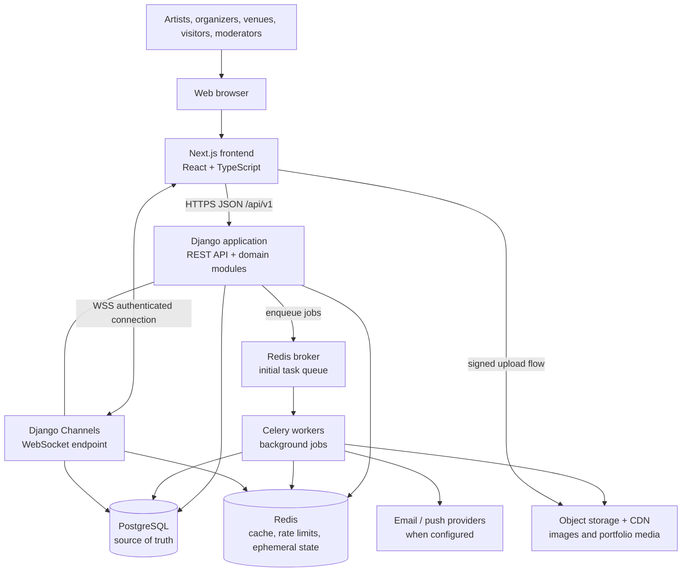

# EQora Architecture (Hour 3)

**Status:** Initial architecture decision  
**Approach:** Modular monolith  
**Backend:** Django + Django REST Framework  
**Frontend:** Next.js + React + TypeScript  
**Primary database:** PostgreSQL  
**Cache / ephemeral state:** Redis

## 1. Architecture decision

EQora will begin as a **modular monolith**: one primary backend application, organized into domain modules with explicit boundaries. Modules live in the same codebase and deploy together, but each module owns its business rules and public interfaces.

This is preferable to starting with microservices because the initial product needs coordinated workflows across identity, social activity, messaging, events, opportunities, applications, and notifications. A modular monolith keeps local development, transactions, deployment, and debugging manageable while preserving a path to extract modules later if measured needs justify it.

## 2. Initial architecture diagram



The diagram is logical rather than a requirement to deploy every box independently. Django REST endpoints and Django Channels can run within the same backend project. For local development, the frontend, backend, PostgreSQL, and Redis can be started with Docker Compose; a worker can be included when asynchronous tasks are introduced.

## 3. Component responsibilities

### Frontend: Next.js, React, TypeScript

- Render public pages, artist and organizer profiles, event and opportunity details, feeds, application flows, and inbox/conversation views.
- Handle client-side navigation, form state, validation for usability, loading/error/empty states, and accessible interactions.
- Call documented backend APIs and maintain authenticated UI state without treating the browser as an authorization boundary.
- Connect to authenticated WebSockets for live message delivery and selected real-time updates.
- Upload media through a controlled signed-upload flow when implemented.
- Never contain server secrets or decide whether a user is allowed to perform a protected action. The backend must re-check permissions.

### Backend: Django + Django REST Framework + Django Channels

- Authenticate users and enforce role, object-level, and action-level permissions.
- Validate requests and own all business rules and state transitions.
- Expose versioned REST APIs under `/api/v1/` and publish an OpenAPI contract.
- Coordinate database transactions for applications, shortlisting, selection, and other consequential workflows.
- Persist messages before acknowledging durable acceptance; authorize every conversation read and send.
- Enqueue slow or retryable work rather than blocking request handlers.
- Expose WebSocket connections through Django Channels, with authentication, participant checks, throttling, and safe reconnect behavior.
- Record audit events for sensitive administrative or moderation actions.

### PostgreSQL: durable source of truth

Store durable product data, including:

- Users, role assignments, profiles, portfolio metadata, and follow relationships.
- Events, standalone or event-linked opportunities, applications, selections, and booking/performance outcomes.
- Posts, comments, likes, share records or share events where needed.
- Conversations, conversation membership, messages, read/unread state, and notification records.
- Blocks, reports, moderation actions, and audit records.

Use foreign keys, unique constraints, indexes, migrations, and transactions to preserve integrity. An event can have zero or more opportunities; an opportunity can be standalone; applications attach to opportunities, not directly to events. Do not store uploaded media binaries in PostgreSQL.

### Redis: fast, temporary data

Use Redis for appropriate ephemeral or performance-oriented workloads:

- Cache entries that can be rebuilt from PostgreSQL.
- Rate-limit counters and short-lived coordination state.
- WebSocket channel-layer coordination and transient presence, if presence is implemented.
- Celery broker/backend only for the initial deployment if that operational choice is retained.

Redis must not be the only durable store for messages, applications, bookings, or notifications. Define cache expiry and invalidation behavior, and design the application to recover from cache loss.

### Celery workers: asynchronous work

Use background jobs for email and push delivery, notification fan-out where it becomes expensive, media processing, scheduled reminders, cleanup tasks, and retryable integrations. Jobs should be idempotent where practical, retry with bounded backoff, and log failures. Persist important in-app notifications in PostgreSQL before or as part of the workflow that creates them; external delivery can happen asynchronously.

### Object storage and CDN

Store profile pictures, portfolio files, and post media outside the application database. Validate file type and size, use randomized object keys, restrict access where needed, and avoid trusting client-supplied content types. Prefer short-lived signed uploads/downloads and serve public media through a CDN where appropriate.

## 4. Backend domain modules

Keep modules in one Django project, with clear ownership:

| Module | Owns |
|---|---|
| `identity` | Accounts, authentication integration, sessions, role assignments, account status |
| `profiles` | Artist, organizer, and venue profiles; portfolio metadata |
| `social` | Posts, feed queries, follows, likes, comments, shares |
| `messaging` | Conversations, membership, durable messages, read state, WebSocket-facing use cases |
| `opportunities` | Events, opportunities/slots, applications, selection and status transitions |
| `notifications` | In-app notification records, preferences, delivery requests |
| `moderation` | Blocks, reports, review queues, moderation actions |
| `media` | Upload authorization, media metadata, validation and processing coordination |
| `common` | Shared primitives only when genuinely cross-domain, such as timestamps and error conventions |

A module owns its models and business rules. Other modules should call its public service/use-case functions rather than changing its tables or bypassing its rules. Avoid a giant shared `utils` module and avoid circular imports. Keep views/controllers thin; put business operations in explicit service functions or use-case classes.

## 5. Dependency and data-flow rules

1. **Frontend → API:** The frontend talks to the backend through documented HTTP APIs and authenticated WebSockets, not directly to PostgreSQL or Redis.
2. **Backend owns truth:** Authorization and validation happen server-side, even if the UI already hides an action.
3. **Modules own their domain:** Cross-module workflows use explicit interfaces. Avoid direct writes into another module's models.
4. **PostgreSQL is durable:** Redis and browser state are disposable and must be reconstructible where appropriate.
5. **Async work is not a transaction substitute:** Commit durable state first, then dispatch side effects safely. For critical events, consider a transactional outbox to avoid losing jobs between database commit and queue publication.
6. **Messages are persisted:** WebSockets deliver updates; they are not the durable message store. Reconnects should fetch missed messages from the API.
7. **Consequential changes are guarded:** Application acceptance, performer selection, event cancellation, and moderation actions require explicit permission checks and valid state transitions.
8. **Observability is built in:** Use structured logs, request IDs, health checks, error tracking, and metrics as the deployment matures.

## 6. Initial repository layout

```text
EQora/
├── frontend/                 # Next.js application
├── backend/
│   ├── config/               # Django settings, URLs, ASGI/WSGI, Celery config
│   ├── apps/
│   │   ├── identity/
│   │   ├── profiles/
│   │   ├── social/
│   │   ├── messaging/
│   │   ├── opportunities/
│   │   ├── notifications/
│   │   ├── moderation/
│   │   └── media/
│   ├── tests/
│   └── manage.py
├── docs/
│   ├── product-requirements.md
│   ├── mvp-and-permissions.md
│   └── architecture.md
├── infra/                    # Deployment configuration as it is added
├── docker-compose.yml
├── .env.example              # Names/placeholders only; no real secrets
└── README.md
```

The exact folder layout can change as implementation starts, but domain boundaries should remain clear.

## 7. Initial deployment shape

For local development, use Docker Compose for the frontend, Django backend, PostgreSQL, and Redis. Add a Celery worker and supporting services when their workflows are introduced. In the first hosted environment, the frontend and backend may be deployed separately, while the backend remains a single modular application. Use managed PostgreSQL and object storage where feasible, keep secrets in environment/secret management, enable HTTPS, and configure automated database backups and restore testing.

Do not introduce Kubernetes, service mesh, Kafka, OpenSearch, or multiple independently deployed domain services by default. Revisit those choices only when scale, team ownership, search needs, or reliability requirements provide evidence.

## 8. Architecture acceptance checklist

- [x] Modular monolith selected.
- [x] Frontend responsibilities documented.
- [x] Backend responsibilities documented.
- [x] PostgreSQL responsibilities documented.
- [x] Redis responsibilities documented.
- [x] Initial architecture diagram included.
- [x] Domain module boundaries and dependency rules documented.
- [ ] Create the initial repository and Docker Compose configuration.
- [ ] Add health endpoints, environment configuration, migrations, and CI checks.
- [ ] Publish the first OpenAPI specification.
- [ ] Validate this architecture against the Hour 1 product requirements and Hour 2 permissions/MVP document before implementation.

## 9. Decisions intentionally deferred

- Hosting provider and exact deployment topology.
- Whether Celery uses Redis or a dedicated broker in production.
- Mobile clients and whether they change the authentication/session strategy.
- Whether search needs a dedicated search engine beyond PostgreSQL full-text search.
- When, if ever, messaging or other modules should be extracted into separately deployed services.
- Push-notification providers and delivery channels beyond in-app notifications.

These are deferred because they do not block defining the initial application boundaries.
